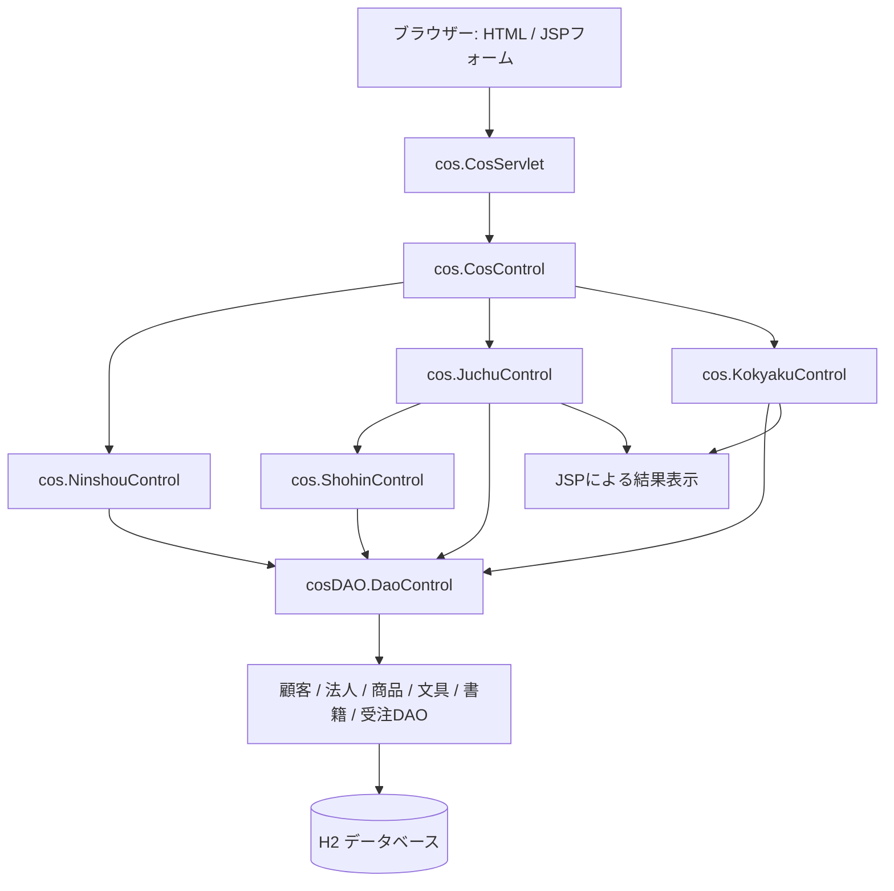

# juchu01 ファイル構成図・ファイル概要

解析日: 2026年11月11日

## 1. 対象と全体概要

`juchu01/`に実在する全ファイル（隠し設定ファイル、画像、ビルド成果物を含む）を対象に、ソースコードと設定内容を静的に解析した。実行確認やDBへの接続は行っていない。

Office GoodyのCustomer Order System（受注システム）。Java Servlet／JSPで構成され、法人顧客登録、ログオン、文具・書籍の商品検索、カート、支払・配送情報入力、受注登録を扱う。Eclipse設定はJava 11／Tomcat 9を指定し、DAOはH2へのJDBC接続を使用する。

保存先はワークスペース内で確認できた既存の`spec`フォルダ、`.metadata/spec/`。以下のパスはすべて`juchu01/`を基準とする。

### ファイル数

| 種別 | ファイル数 |
| --- | ---: |
| `(拡張子なし)` | 3 |
| `.bat` | 4 |
| `.class` | 24 |
| `.component` | 1 |
| `.container` | 1 |
| `.css` | 1 |
| `.html` | 1 |
| `.java` | 24 |
| `.jpg` | 257 |
| `.js` | 1 |
| `.jsp` | 17 |
| `.mf` | 1 |
| `.name` | 1 |
| `.prefs` | 2 |
| `.xml` | 2 |
| **合計** | **340** |

## 2. ファイル構成図

全ファイル名を省略せず記載する。`build/classes/`は生成物、`src/`はJavaソース、`WebContent/`はWeb公開資材、`.settings/`等は開発環境設定。

```text
juchu01/
├── .settings/
│   ├── .jsdtscope
│   ├── org.eclipse.jdt.core.prefs
│   ├── org.eclipse.wst.common.component
│   ├── org.eclipse.wst.common.project.facet.core.xml
│   ├── org.eclipse.wst.html.core.prefs
│   ├── org.eclipse.wst.jsdt.ui.superType.container
│   └── org.eclipse.wst.jsdt.ui.superType.name
├── WebContent/
│   ├── META-INF/
│   │   └── MANIFEST.MF
│   ├── WEB-INF/
│   │   ├── lib/
│   │   └── web.xml
│   ├── css/
│   │   └── common1.css
│   ├── img/
│   │   ├── book/
│   │   │   ├── 0201-00901-001.jpg
│   │   │   ├── 0201-00901-002.jpg
│   │   │   ├── 0201.JPG
│   │   │   └── book.bat
│   │   └── bungu/
│   │       ├── 0101-00101-001.jpg
│   │       ├── 0101.JPG
│   │       ├── bungu1.bat
│   │       ├── bungu2.bat
│   │       └── bungu3.bat
│   ├── js/
│   │   └── common1.js
│   ├── cosd1000.html
│   ├── cosd1010.jsp
│   ├── cosd1020.jsp
│   ├── cosd1030.jsp
│   ├── cosd1040.jsp
│   ├── cosd1041.jsp
│   ├── cosd1050.jsp
│   ├── cosd1060.jsp
│   ├── cosd1070.jsp
│   ├── cosd1080.jsp
│   ├── cosd1090.jsp
│   ├── cosd1100.jsp
│   ├── cosd1110.jsp
│   ├── cosd150E.jsp
│   ├── cosd151E.jsp
│   ├── cosd152E.jsp
│   ├── cosd153E.jsp
│   └── cosd155E.jsp
├── build/
│   └── classes/
│       ├── cos/
│       │   └── ShohinControl.class
│       ├── cosDAO/
│       │   └── DaoShohin.class
│       └── cosDataPack/
│           └── ShohinPrimalData.class
├── src/
│   ├── cos/
│   │   ├── BaseControl.java
│   │   ├── CosControl.java
│   │   ├── CosServlet.java
│   │   ├── JuchuControl.java
│   │   ├── KokyakuControl.java
│   │   ├── NinshouControl.java
│   │   └── ShohinControl.java
│   ├── cosDAO/
│   │   ├── DaoBook.java
│   │   ├── DaoBungu.java
│   │   ├── DaoConnectionManager.java
│   │   ├── DaoControl.java
│   │   ├── DaoHoujin.java
│   │   ├── DaoJuchu.java
│   │   ├── DaoKokyaku.java
│   │   └── DaoShohin.java
│   └── cosDataPack/
│       ├── Book.java
│       ├── Bungu.java
│       ├── Houjin.java
│       ├── Juchu.java
│       ├── Kokyaku.java
│       ├── Meisai.java
│       ├── Shohin.java
│       ├── ShohinCategory.java
│       └── ShohinPrimalData.java
├── .classpath
└── .project
```

## 3. 主な処理の関係



`cosDataPack`のオブジェクトをDAO・制御クラス・JSP間で利用する。`JuchuControl`、`KokyakuControl`、詳細表示対象の商品はセッションに保持され、JSPから参照される。

## 4. 各ファイルの概要

### 開発環境・プロジェクト設定

| ファイル（juchu01からの相対パス） | 概要 |
| --- | --- |
| `.classpath` | Java 11、Tomcat 9のクラスパス、ソースsrcと出力先build/classesを定義する。 |
| `.project` | Eclipseプロジェクト名、Javaビルダー、検証機能、Webプロジェクトの性質を定義する。 |
| `.settings/.jsdtscope` | WebContentを対象としたJavaScriptの参照ライブラリと解析範囲を設定する。 |
| `.settings/org.eclipse.jdt.core.prefs` | Javaソース・コンパイラー準拠レベル・生成バイトコードをJava 11に設定する。 |
| `.settings/org.eclipse.wst.common.component` | WebContentを公開ルート、srcをWEB-INF/classesへ配置する設定とコンテキストルートjuchu01を定義する。 |
| `.settings/org.eclipse.wst.common.project.facet.core.xml` | Tomcat 9、Java 11、Dynamic Web Module 4.0、JavaScriptのプロジェクトファセットを定義する。 |
| `.settings/org.eclipse.wst.html.core.prefs` | Eclipse HTMLエディターの文書種別設定を保持する。 |
| `.settings/org.eclipse.wst.jsdt.ui.superType.container` | JavaScriptのグローバル型の参照先をブラウザーライブラリに設定する。 |
| `.settings/org.eclipse.wst.jsdt.ui.superType.name` | JavaScriptのグローバル型をWindowに設定する。 |

### 業務制御: src/cos

| ファイル（juchu01からの相対パス） | 概要 |
| --- | --- |
| `src/cos/BaseControl.java` | コントロールの抽象基底クラス。DAO、セッション、コマンド、ボタンと遷移先の対応表を保持し、UTF-8設定などの共通受付処理を提供する。 |
| `src/cos/CosControl.java` | システムの受付・振り分け処理。top・order・userパラメーターを判定し、認証、受注、顧客登録、ログオフへ処理を移譲する。 |
| `src/cos/CosServlet.java` | HTTP POSTの受付を行い、リクエストとレスポンスをCosControlへ渡すサーブレット。初期化処理とdoDeleteも定義する。 |
| `src/cos/JuchuControl.java` | 受注処理と画面遷移を制御する。商品検索・詳細取得、カート追加・数量再計算、納品・支払情報設定、受注確定、エラー画面への分岐を担当する。 |
| `src/cos/KokyakuControl.java` | 法人ユーザー登録の入力・確認・登録処理と画面遷移を制御する。都道府県一覧、顧客データ、セッション内の登録状態を管理する。 |
| `src/cos/NinshouControl.java` | 顧客IDとパスワードによるログオン、認証失敗画面への転送、ログオフ時のセッション破棄とトップ画面への転送を行う。 |
| `src/cos/ShohinControl.java` | 商品検索用の窓口。商品カテゴリー一覧・商品一覧や詳細の取得をDaoControlへ委譲する。 |

### DBアクセス: src/cosDAO

| ファイル（juchu01からの相対パス） | 概要 |
| --- | --- |
| `src/cosDAO/DaoBook.java` | BOOK_TABLEを中心に書籍の詳細情報と在庫情報を検索し、Bookオブジェクトの一覧として返す。 |
| `src/cosDAO/DaoBungu.java` | BUNGU_TABLEを中心に文具の詳細情報と在庫情報を検索し、Bunguオブジェクトの一覧として返す。 |
| `src/cosDAO/DaoConnectionManager.java` | DB接続マネージャー。ローカルのH2 TCPデータベースcoscommon01へのJDBC接続を提供する。 |
| `src/cosDAO/DaoControl.java` | 業務制御からのDBアクセスを集約し、顧客登録・認証、都道府県取得、商品検索、受注登録を各DAOへ振り分ける。接続の取得・終了も扱う。 |
| `src/cosDAO/DaoHoujin.java` | 法人顧客の検索と登録を行う。KOKYAKUHOUJIN_TABLE、KOKYAKUPASS_TABLE、採番管理を扱い、メール重複確認などを実施する。 |
| `src/cosDAO/DaoJuchu.java` | 受注登録を担当する。受注・明細、受注番号、売掛残、在庫引当を扱い、在庫確認と与信判定、トランザクション処理を行う。 |
| `src/cosDAO/DaoKokyaku.java` | 顧客DAOの基底クラス。Statement管理、顧客コード取得、出荷担当営業所取得、ID・パスワード照合、郵便番号等の分割、拡張用の登録・検索メソッドを提供する。 |
| `src/cosDAO/DaoShohin.java` | 商品DAOの基底クラス。カテゴリー一覧とサブカテゴリー別商品一覧を取得し、メーカー、単価、営業所別在庫などを商品オブジェクトへ設定する。 |

### データモデル: src/cosDataPack

| ファイル（juchu01からの相対パス） | 概要 |
| --- | --- |
| `src/cosDataPack/Book.java` | Shohinを継承する書籍データ。巻数、ISBN-10/13、著者、ページ数、発行日、寸法を追加する。 |
| `src/cosDataPack/Bungu.java` | Shohinを継承する文具データ。色、型番、寸法、材質を追加する。 |
| `src/cosDataPack/Houjin.java` | Kokyakuを継承する法人顧客データ。業種、担当者名、担当部署と画面表示用の空文字初期化を追加する。 |
| `src/cosDataPack/Juchu.java` | 受注・カートのデータ。顧客、明細一覧、合計金額、税率、支払方法、納品予定、エラー状態を保持し、明細追加・更新と合計計算を行う。 |
| `src/cosDataPack/Kokyaku.java` | 顧客の共通データ。顧客コード・名称、住所、連絡先、パスワード、担当営業所、売掛残、与信限度、登録日、エラーフラグを保持する。 |
| `src/cosDataPack/Meisai.java` | 受注明細1行のデータ。商品基本情報、行番号、数量、金額、納品予定日・時間帯、引当エラー状態を保持し、数量×販売単価で金額を計算する。 |
| `src/cosDataPack/Shohin.java` | 商品の共通データ。基本情報、カテゴリー、メーカー、入り数・単位、コメント、画像URL、在庫数・引当数を保持し、引当可能数から在庫表示を算出する。 |
| `src/cosDataPack/ShohinCategory.java` | 商品カテゴリー・サブカテゴリーのコードと名称、対応クラス名を保持する。商品コードからカテゴリーコードを設定する補助メソッドも持つ。 |
| `src/cosDataPack/ShohinPrimalData.java` | 商品コード、商品名、販売単価をまとめた商品基本情報。商品と受注明細で利用する。 |

### 画面・Web設定・共通資材

| ファイル（juchu01からの相対パス） | 概要 |
| --- | --- |
| `WebContent/META-INF/MANIFEST.MF` | Webアプリケーションのマニフェスト。バージョン1.0と空のClass-Pathを記載する。 |
| `WebContent/WEB-INF/web.xml` | Webアプリ名、welcome-file候補、cos.CosServletとURL /CosServletの対応を定義する（記述子バージョン2.5）。 |
| `WebContent/cosd1000.html` | トップページ。ユーザーID・パスワードによるログオンと法人ユーザーの新規登録への入口。 |
| `WebContent/cosd1010.jsp` | 商品検索画面。カテゴリー選択とカートの件数・金額を表示する。 |
| `WebContent/cosd1020.jsp` | カテゴリー別商品リスト。単価・在庫状況を表示し、購入数量入力、カート追加、商品詳細表示を受け付ける。 |
| `WebContent/cosd1030.jsp` | カート内の注文リスト。数量変更・再計算、購入継続、注文手続きへの移動を行う。 |
| `WebContent/cosd1040.jsp` | 文具の詳細説明。商品画像、コメント、単価、色・型番・寸法・材質などを表示する。 |
| `WebContent/cosd1041.jsp` | 書籍の詳細説明。商品画像、コメント、単価、著者・ISBN・発行日などを表示する。 |
| `WebContent/cosd1050.jsp` | 注文内容の確認画面。カートの明細・金額を確認し、支払・配送情報入力へ進む。 |
| `WebContent/cosd1060.jsp` | 支払方法・お届け先の入力画面。顧客の配送先情報を表示し、支払方法、納品予定日、時間帯を指定する。 |
| `WebContent/cosd1070.jsp` | 注文確定前の確認画面。注文内容と支払・配送情報を表示し、確定または入力画面への戻りを受け付ける。 |
| `WebContent/cosd1080.jsp` | 注文確定結果画面。登録された受注情報・明細を表示する。 |
| `WebContent/cosd1090.jsp` | 法人ユーザー情報の入力画面。会社名、住所、連絡先、担当者、パスワードなどを入力する。 |
| `WebContent/cosd1100.jsp` | ユーザー情報の確認画面。入力内容を表示し、修正または登録を受け付ける。 |
| `WebContent/cosd1110.jsp` | ユーザー登録完了画面。登録結果を表示し、トップページへの移動を案内する。 |
| `WebContent/cosd150E.jsp` | ログオン失敗画面。認証できなかったことを通知する。 |
| `WebContent/cosd151E.jsp` | 在庫引当エラー画面。在庫切れの商品を含む注文内容を表示する。 |
| `WebContent/cosd152E.jsp` | 与信エラー画面。注文を受け付けられなかったことを通知する。 |
| `WebContent/cosd153E.jsp` | ユーザー登録エラー画面。登録済みなどの顧客エラー状態に応じたメッセージを表示する。 |
| `WebContent/cosd155E.jsp` | システムエラー画面。登録処理を完了できなかったことを通知する。 |
| `WebContent/css/common1.css` | ヘッダー、フッター、画面レイアウト、商品一覧、カート、入力フォームなどの共通スタイルを定義する。 |
| `WebContent/js/common1.js` | 登録フォームの必須入力・パスワード長・確認値一致を検証する。押下ボタンや商品コードを設定し、詳細画面の別ウィンドウ表示と送信先の復元を行う。 |

### 書籍画像・複製バッチ

| ファイル（juchu01からの相対パス） | 概要 |
| --- | --- |
| `WebContent/img/book/0201-00901-001.jpg` | 商品コード`0201-00901-001`に対応する書籍の商品画像。画像の役割は配置・ファイル名・バッチ内容から判定。 |
| `WebContent/img/book/book.bat` | 元画像（`0201.jpg`、`0202.jpg`）を商品コード別のJPEG名へ複製するWindowsバッチ。 |

### 文具画像・複製バッチ

| ファイル（juchu01からの相対パス） | 概要 |
| --- | --- |
| `WebContent/img/bungu/0101-00101-001.jpg` | 商品コード`0101-00101-001`に対応する文具の商品画像。画像の役割は配置・ファイル名・バッチ内容から判定。 |
| `WebContent/img/bungu/0110.JPG` | 文具の画像複製バッチで参照されるサブカテゴリー0110の元画像。画像の役割は配置・ファイル名・バッチ内容から判定。 |
| `WebContent/img/bungu/bungu1.bat` | 元画像（`0101.jpg`）を商品コード別のJPEG名へ複製するWindowsバッチ。 |
| `WebContent/img/bungu/bungu2.bat` | 元画像（`0102.jpg`、`0103.jpg`）を商品コード別のJPEG名へ複製するWindowsバッチ。 |
| `WebContent/img/bungu/bungu3.bat` | 元画像（`0104.jpg`、`0105.jpg`、`0106.jpg`、`0107.jpg`、`0108.jpg`、`0109.jpg`、`0110.jpg`）を商品コード別のJPEG名へ複製するWindowsバッチ。 |

### コンパイル済みクラス

| ファイル（juchu01からの相対パス） | 概要 |
| --- | --- |
| `build/classes/cos/BaseControl.class` | `src/cos/BaseControl.java`に対応するコンパイル済みJavaクラス。ソースとの内容一致は未検証。 |
| `build/classes/cos/CosControl.class` | `src/cos/CosControl.java`に対応するコンパイル済みJavaクラス。ソースとの内容一致は未検証。 |
| `build/classes/cos/CosServlet.class` | `src/cos/CosServlet.java`に対応するコンパイル済みJavaクラス。ソースとの内容一致は未検証。 |
| `build/classes/cos/JuchuControl.class` | `src/cos/JuchuControl.java`に対応するコンパイル済みJavaクラス。ソースとの内容一致は未検証。 |
| `build/classes/cos/KokyakuControl.class` | `src/cos/KokyakuControl.java`に対応するコンパイル済みJavaクラス。ソースとの内容一致は未検証。 |
| `build/classes/cos/NinshouControl.class` | `src/cos/NinshouControl.java`に対応するコンパイル済みJavaクラス。ソースとの内容一致は未検証。 |
| `build/classes/cos/ShohinControl.class` | `src/cos/ShohinControl.java`に対応するコンパイル済みJavaクラス。ソースとの内容一致は未検証。 |
| `build/classes/cosDAO/DaoBook.class` | `src/cosDAO/DaoBook.java`に対応するコンパイル済みJavaクラス。ソースとの内容一致は未検証。 |
| `build/classes/cosDAO/DaoBungu.class` | `src/cosDAO/DaoBungu.java`に対応するコンパイル済みJavaクラス。ソースとの内容一致は未検証。 |
| `build/classes/cosDAO/DaoConnectionManager.class` | `src/cosDAO/DaoConnectionManager.java`に対応するコンパイル済みJavaクラス。ソースとの内容一致は未検証。 |
| `build/classes/cosDAO/DaoControl.class` | `src/cosDAO/DaoControl.java`に対応するコンパイル済みJavaクラス。ソースとの内容一致は未検証。 |
| `build/classes/cosDAO/DaoHoujin.class` | `src/cosDAO/DaoHoujin.java`に対応するコンパイル済みJavaクラス。ソースとの内容一致は未検証。 |
| `build/classes/cosDAO/DaoJuchu.class` | `src/cosDAO/DaoJuchu.java`に対応するコンパイル済みJavaクラス。ソースとの内容一致は未検証。 |
| `build/classes/cosDAO/DaoKokyaku.class` | `src/cosDAO/DaoKokyaku.java`に対応するコンパイル済みJavaクラス。ソースとの内容一致は未検証。 |
| `build/classes/cosDAO/DaoShohin.class` | `src/cosDAO/DaoShohin.java`に対応するコンパイル済みJavaクラス。ソースとの内容一致は未検証。 |
| `build/classes/cosDataPack/Book.class` | `src/cosDataPack/Book.java`に対応するコンパイル済みJavaクラス。ソースとの内容一致は未検証。 |
| `build/classes/cosDataPack/Bungu.class` | `src/cosDataPack/Bungu.java`に対応するコンパイル済みJavaクラス。ソースとの内容一致は未検証。 |
| `build/classes/cosDataPack/Houjin.class` | `src/cosDataPack/Houjin.java`に対応するコンパイル済みJavaクラス。ソースとの内容一致は未検証。 |
| `build/classes/cosDataPack/Juchu.class` | `src/cosDataPack/Juchu.java`に対応するコンパイル済みJavaクラス。ソースとの内容一致は未検証。 |
| `build/classes/cosDataPack/Kokyaku.class` | `src/cosDataPack/Kokyaku.java`に対応するコンパイル済みJavaクラス。ソースとの内容一致は未検証。 |
| `build/classes/cosDataPack/Meisai.class` | `src/cosDataPack/Meisai.java`に対応するコンパイル済みJavaクラス。ソースとの内容一致は未検証。 |
| `build/classes/cosDataPack/Shohin.class` | `src/cosDataPack/Shohin.java`に対応するコンパイル済みJavaクラス。ソースとの内容一致は未検証。 |
| `build/classes/cosDataPack/ShohinCategory.class` | `src/cosDataPack/ShohinCategory.java`に対応するコンパイル済みJavaクラス。ソースとの内容一致は未検証。 |
| `build/classes/cosDataPack/ShohinPrimalData.class` | `src/cosDataPack/ShohinPrimalData.java`に対応するコンパイル済みJavaクラス。ソースとの内容一致は未検証。 |

## 5. 構成上の補足

- `.classpath`は`src/`を入力、`build/classes/`を出力とし、Web配置設定はJavaクラスを`WEB-INF/classes`へ配置する。両ディレクトリのJava／classファイルはそれぞれ24件。
- プロジェクトファセットのWebバージョンは4.0だが、`web.xml`の記述子は2.5。異なる設定値として記録する。
- `web.xml`のwelcome-file候補に`cosd1000.html`は含まれず、候補のindex／defaultファイルも対象内には存在しない。トップ画面の実ファイルは`WebContent/cosd1000.html`。
- 対象フォルダ内にMaven／Gradleビルド定義、テストコード、DB作成SQL、JDBCドライバーJARは見当たらない。実行環境やDBの実体はこのフォルダだけでは確定できない。
- 画像はファイルごとに一覧化した。商品名・絵柄は画像を目視判定しておらず、商品コードと画像ファイルの対応は命名と複製バッチを根拠に記載した。
- 元画像の拡張子は実ファイルが`.JPG`、バッチ内の参照が`.jpg`。Windows向けバッチの表記としてそのまま記録した。
